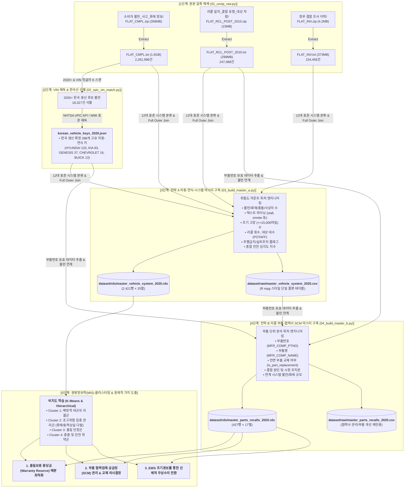

# 한국 생산 수출 자동차와 리콜 위험 예측 및 품질 보증 자원 배분
### NHTSA 소비자 불만(Complaints), 리콜(Recalls), 결함 조사(Investigations) 기반 단일 마스터 데이터셋 구축 및 분석 파이프라인

- **연구 과제**: 한국 생산 수출 자동차와 리콜 위험 예측과 품질 보증 자원 배분 : NHTSA 소비자 불만 및 조사 자료를 중심으로
- **과목**: 경영정보분석 (Business Information Systems & Analytics)
- **기준 범위**: 2020년 이후(`Model Year >= 2020`) 한국 생산 및 미국 수출 승용/SUV 차량 (현대, 기아, 제네시스, 한국GM 등)
- **최종 산출물**: R의 `mpg` 데이터셋 스타일 단일 플랫 마스터셋 (`.rds`, `.csv`) 2종 및 재현 파이프라인

---

## 1. 전체 파이프라인 플로우 (End-to-End Pipeline Flow)



---

## 2. 연구 배경 및 경영정보학(MIS)적 가치

완성차 제조사는 매년 수천억~수조 원에 달하는 **품질보증 충당부채(Warranty Reserve)**를 설정합니다. 전통적인 방식은 과거 판매 대수에 비례하여 일률적으로 충당금을 적립했으나, 최근 전기차 부품(고전압 배터리, ICCU) 및 전자장비(ADAS, ESC 모듈), 파워트레인 세부 부품의 결함으로 인한 대규모 리콜 리스크가 급증하고 있습니다.

본 프로젝트는 미국 도로교통안전국(NHTSA)의 빅데이터를 기반으로 다음 세 가지 경영학적 의사결정을 실증 지원하기 위해 구축되었습니다:
1. **조기 경보 시스템 (Early Warning System, EWS)**: 정식 리콜 및 정부 결함 조사가 개시되기 전, 소비자 불만(주행거리, 고장 텍스트 패턴)을 군집화하여 잠재적 리콜 위험을 선제 감지.
2. **동적 품질보증 충당금 배분 최적화**: 차량-시스템별 리스크 군집(Cluster) 평가를 바탕으로 차등화된 보증 자원 배분.
3. **부품 협력업체 공급망(SCM) 관리 및 구상권 청구**: 리콜 부품 파트번호(`Part No.`)와 전면 부품 교체 여부를 추적하여 1차 협력사(Tier-1 Supplier) 교체, 품질보증 비용 분담(Cost-sharing) 계약 근거 확보.

---

## 3. 원천 데이터 출처 (Data Provenance & Sources)

본 연구의 데이터는 미국 연방 정부 기관인 **NHTSA(National Highway Traffic Safety Administration)**의 공식 공공 데이터베이스를 전수 취합하여 구축되었습니다:

| 데이터 명칭 | 원본 파일 | 규모 | 설명 | 공식 출처 |
|---|---|:---:|---|---|
| **소비자 불만 신고** | `FLAT_CMPL.zip` / `FLAT_CMPL.txt` | 2,261,996건 (1.6GB) | 미국 소비자가 제기한 차량 결함/사고/화재 신고 전수 데이터 | [NHTSA Complaints Data](https://www.nhtsa.gov/nhtsa-datasets-and-apis#complaints) |
| **공식 리콜 캠페인** | `FLAT_RCL_POST_2010.zip` / `FLAT_RCL_POST_2010.txt` | 247,088건 (299MB) | 2010년 이후 연방 안전기준 결함으로 고시된 공식 리콜 캠페인 | [NHTSA Recalls Data](https://www.nhtsa.gov/nhtsa-datasets-and-apis#recalls) |
| **정부 결함 조사** | `FLAT_INV.zip` / `FLAT_INV.txt` | 154,456건 (373MB) | NHTSA ODI(Office of Defects Investigation) 공식 결함 조사 내역 | [NHTSA Investigations Data](https://www.nhtsa.gov/nhtsa-datasets-and-apis#investigations) |
| **차대번호(VIN) 해독 DB** | `vPIC Database / API` | REST API / Batch | 차량 생산국가, 생산공장, 제조사, 차종 사양 공식 해독 시스템 | [NHTSA vPIC API](https://vpic.nhtsa.dot.gov/api/) |

---

## 4. 데이터 선별 및 전처리 세부 내역 (학술 근거)

### 4.1. [1단계] VIN 디코딩을 통한 한국 생산 차량 선별
- **목적**: 미국 시장에서 판매된 차량 중 한국 공장(울산, 아산, 광주, 창원, 부평 등)에서 조립·수출된 차량만을 과학적으로 분리.
- **방법**:
  - `FLAT_CMPL.txt` 내 226만 건의 VIN에서 한국 제조사 표준 식별 기호인 첫 글자 `K`(Korea) 스캔.
  - WMI(World Manufacturer Identifier) 표준 규격(ISO 3779/3780) 및 NHTSA 공식 vPIC API를 통해 공장 국가(`PlantCountry`), 공장 도시(`PlantCity`), 공장명(`PlantCompanyName`) 해독.
  - 허용 국가명: `KOR`, `KOREA`, `KOREA REP OF`, `KOREA REPUBLIC OF`, `KOREA SOUTH`, `KR`, `REPUBLIC OF KOREA`, `SOUTH KOREA`
  - 이를 통해 **286개의 고유 한국산 차종-연식 키(Make, Model, Year)**를 확정하고, 불만 18,327건을 1차 선별.

### 4.2. [2단계] 2020년 이후(`Year >= 2020`) 데이터 한정 사유
본 연구가 2020년 이후 차량으로 범위를 한정한 학술적·실증적 근거는 다음과 같습니다:

1. **부품 번호(`Part No.`) 데이터의 완전성 확보**:
   - 2020년 이전 리콜 데이터: 제조사 부품명(`MFR_COMP_NAME`) 및 부품번호(`MFR_COMP_PTNO`) 기재율 **48.8%** (데이터 절반 이상 결측).
   - 2020년 이후 리콜 데이터: 부품명 및 부품번호 기재율 **99.2%**.
   - 따라서 부품 협력업체 교체 및 개별 품질 부품 개선 제안이라는 연구 목표를 실증하려면 2020년 이후 데이터가 필수적입니다.
2. **핵심 신기술 품질 이슈의 집중**:
   - 현대·기아·제네시스의 차세대 E-GMP 플랫폼 전기차(아이오닉 5/6, EV6, GV60)의 고전압 배터리 및 ICCU 이슈, 누우 2.0 엔진 피스톤 링 결함, 첨단 운전자 보조 시스템(ADAS) 등 현대 자동차 산업의 핵심 품질 이슈가 2020년 이후 연식에 집중되어 있습니다.

### 4.3. [3단계] 단일 마스터셋 구축 및 데이터 누락 0% 보장
- **분석 단위 왜곡(Cartesian Explosion) 방지**:
  - 세 원본 파일을 공통 키로 단순 JOIN하면 행이 무작정 폭발하여 특정 차종의 불만과 무관한 리콜 부품이 결합되는 치명적인 유령 결합(Phantom Rows)이 발생합니다.
  - 이를 방지하기 위해 관측 단위를 **`[제조사 - 차종 - 연식 - 표준시스템]`**으로 통합하고 모든 위험 지표를 카운트(Count)형 피처로 집계하여 R의 `mpg` 데이터셋처럼 결측치 없는 완전한 2차원 플랫 매트릭스를 구축했습니다.
- **Full Outer Join (완전 외부 조인) 적용**:
  - 불만만 있는 차종, 리콜만 있는 차종, 조사만 있는 차종이 단 1건도 버려지지 않고 100% 보존되었습니다.
  - 리콜이 없는 행은 `recall_count = 0`, 조사가 없는 행은 `inv_count = 0`으로 자동 전처리되었습니다.

---

## 5. 최종 마스터 데이터셋 2종 상세 스키마

### 5.1. [데이터셋 1] `master_vehicle_system_2020` (클러스터링용)
- **파일 경로**: `dataset/rds/master_vehicle_system_2020.rds` (및 `.csv`)
- **관측 단위**: 1행 = `[Make - Model - Year - System]` (2,421행 × 25열)
- **변수 정의**:

| 컬럼명 | 자료형 | 설명 |
|---|:---:|---|
| `make` | 문자 | 제조사 브랜드 (HYUNDAI, KIA, GENESIS, BUICK, CHEVROLET 등) |
| `model` | 문자 | 차종명 (IONIQ 5, EV6, SOUL, TUCSON, G70, TRAILBLAZER 등) |
| `year` | 정수 | 모델 연식 (2020 ~ 2026) |
| `system` | 문자 | 12대 표준 시스템 분류 (ENGINE, ELECTRICAL, BRAKES, POWERTRAIN, SEAT_BELTS 등) |
| `cmpl_count` | 정수 | 해당 차종-시스템에 접수된 총 소비자 불만 건수 |
| `fire_count` | 정수 | 화재 발생 신고 건수 (`FIRE == "Y"`) |
| `crash_count` | 정수 | 충돌 사고 신고 건수 (`CRASH == "Y"`) |
| `inj_count` | 정수 | 부상자 수 합계 |
| `death_count` | 정수 | 사망자 수 합계 |
| `stall_count` | 정수 | 비정형 텍스트 마이닝 기반 시동꺼짐/동력상실(stall, loss of power) 언급 건수 |
| `smoke_fire_text_count` | 정수 | 텍스트 마이닝 기반 연기/타는 냄새/불꽃 언급 건수 |
| `early_fail_count` | 정수 | 출고 초기(15,000마일 이하) 조기 고장 건수 |
| `avg_fail_miles` | 실수 | 고장 발생 평균 주행거리 (마일) |
| `recall_count` | 정수 | 공식 리콜 캠페인 실시 횟수 |
| `distinct_parts_count` | 정수 | 결함이 공식 인정된 세부 부품 가짓수 |
| `max_potaff` | 실수 | 리콜 대상 차량 최대 규모 (대수) |
| `park_outside_yn` | 정수 | 화재 위험으로 인한 실외 주차 권고 여부 (1/0) |
| `do_not_drive_yn` | 정수 | 즉각 주행 금지 명령 포함 여부 (1/0) |
| `key_part_names` | 문자 | 대표 결함 부품 명칭 (상위 2개) |
| `key_part_numbers` | 문자 | 대표 결함 부품 파트 번호 (Part No.) |
| `inv_count` | 정수 | NHTSA ODI 정부 공식 결함조사 착수 건수 |
| `active_inv_yn` | 정수 | 정부 결함조사 착수 여부 (1/0) |
| `risk_severity_index` | 실수 | **안전 심각도 종합 지수** (화재×3 + 충돌×2 + 부상×2 + 사망×10 + 주행금지×10 등 가중 합산) |
| `early_fail_ratio` | 실수 | 조기 고장 비율 (`early_fail_count / cmpl_count`) |
| `has_recall` | 정수 | 리콜 발생 여부 (1=리콜 발생, 0=미발생) - 분류 라벨용 |

---

### 5.2. [데이터셋 2] `master_parts_recalls_2020` (협력사 SCM & 부품 교체용)
- **파일 경로**: `dataset/rds/master_parts_recalls_2020.rds` (및 `.csv`)
- **관측 단위**: 1행 = `[리콜캠페인(CAMPNO) - 세부부품번호(Part No.)]` (427행 × 17열)
- **변수 정의**:

| 컬럼명 | 자료형 | 설명 |
|---|:---:|---|
| `campno` | 문자 | NHTSA 공식 리콜 번호 (예: 20V543000, 23V181000) |
| `mfr_comp_ptno` | 문자 | **제조사 세부 부품 파트 번호** (예: 58920-D3530, 37501-K4000) |
| `mfr_comp_name` | 문자 | 제조사 세부 부품 명칭 (예: ABS Assembly, Fuel Pump) |
| `system` | 문자 | 표준 시스템 대분류 |
| `make` | 문자 | 제조사 |
| `affected_models` | 문자 | 해당 부품 결함이 적용된 대상 차종 목록 (콤마 구분) |
| `model_year_min/max` | 정수 | 적용 연식 범위 |
| `potaff` | 실수 | 해당 리콜 대상 총 차량 대수 |
| `park_outside_yn` | 정수 | 실외 주차 권고 여부 |
| `do_not_drive_yn` | 정수 | 주행 금지 명령 여부 |
| `is_part_replacement` | 정수 | **전면 부품 교체 여부 (1=부품 전면 교체, 0=점검/SW업데이트)** |
| `is_sw_update_only` | 정수 | 소프트웨어 패치 전용 여부 |
| `desc_defect` | 문자 | 공식 결함 원인 기술문 |
| `corrective_action` | 문자 | 제조사의 공식 시정 조치 방안 |
| `linked_system_cmpl_count` | 정수 | 해당 시스템의 누적 소비자 불만 건수 |
| `linked_system_fire_count` | 정수 | 해당 시스템의 누적 화재 신고 건수 |

---

## 6. 전체 파이프라인 원클릭 실행 방법 (Quickstart)

```bash
# 1. build_py 폴더로 이동
cd /home/kms/MyProjectSave/경정분단일데이터셋/dataset/build_py

# 2. 통합 파이프라인 원클릭 실행 (압축 해제부터 RDS 생성까지 약 15초 소요)
python3 run_pipeline.py

# 3. R에서 불러와 클러스터링 분석 시작
R -e "
veh <- readRDS('../rds/master_vehicle_system_2020.rds')
parts <- readRDS('../rds/master_parts_recalls_2020.rds')
cat('Master Vehicle System loaded: ', dim(veh), '\n')
cat('Master Parts Recalls loaded : ', dim(parts), '\n')
"
```

---

## 7. 학술 인용 및 공식 출처 표기 (Citation & References)

논문 작성 시 데이터 출처로 다음 항목을 기재하십시오:

1. **National Highway Traffic Safety Administration (NHTSA)** (2026). *Office of Defects Investigation (ODI) Complaints, Recalls, and Investigation Flat Files*. U.S. Department of Transportation. Available at: https://www.nhtsa.gov/nhtsa-datasets-and-apis
2. **NHTSA Vehicle Product Information Catalog and Alpha-Numeric Index (vPIC)** (2026). *vPIC Vehicle Identification Number (VIN) Decoding System*. U.S. Department of Transportation. Available at: https://vpic.nhtsa.dot.gov/api/
