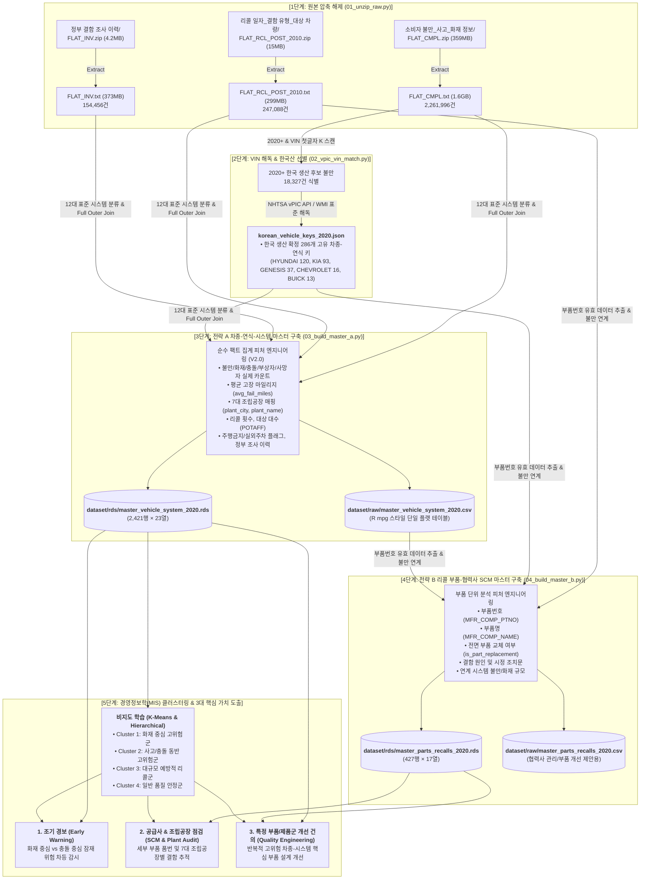

# 한국 생산 수출 자동차의 리콜 위험 예측과 품질 관리 (NHTSA 자료를 중심으로)
### NHTSA 소비자 불만(Complaints), 리콜(Recalls), 결함 조사(Investigations) 기반 단일 마스터 데이터셋 구축 (V2.1 Pure Fact-based & Full Parts Preservation Release)

- **연구 과제**: 한국 생산 수출 자동차의 리콜 위험 예측과 품질 관리 (NHTSA 자료를 중심으로)
- **과목**: 경영정보분석 (Business Information Systems & Analytics)
- **기준 범위**: 2020년 이후(`Model Year >= 2020`) 한국 생산 및 미국 수출 승용/SUV 차량 (현대, 기아, 제네시스, 한국GM 등)
- **데이터셋 버전**: **v2.1** (인위적 가중치 배제 및 결함 부품 품번 슬라이싱 없는 100% 완전 전수 보존 버전)
- **최종 산출물**: R의 `mpg` 데이터셋 스타일 단일 플랫 마스터셋 (`.rds`, `.csv`) 2종 및 재현 파이프라인

---

## 1. 전체 파이프라인 플로우 (End-to-End Pipeline Flow)



---

## 2. 연구 배경 및 경영정보학(MIS)적 3대 핵심 가치

완성차 제조사는 매년 수천억~수조 원에 달하는 **품질보증 충당부채(Warranty Reserve)**를 설정하며, 최근 고전압 배터리, 통합충전제어장치(ICCU), 전동식 조향장치(MDPS), 첨단 운전자 보조 시스템(ADAS) 등 복잡한 전자·전장 모듈의 도입으로 품질 관리의 복잡성이 급격히 증가하고 있습니다.

본 연구는 미국 도로교통안전국(NHTSA)의 방대한 빅데이터를 기반으로 비지도 학습(Clustering)을 적용하여 다음 세 가지 실무적 가치를 창출합니다:

1. **조기 경보 (Early Warning System)**:
   - 심각도와 위험 징후가 높은 잠재 위험 군집을 선제 식별하고, 결함의 특성이 **화재 중심(Fire-centric)**인지, **사고/충돌 동반 중심(Crash-centric)**인지에 맞추어 차등 감시 체계를 수립하고 품질보증 자원을 효율적으로 배분합니다.
2. **공급사 및 조립공장 점검 (Supplier SCM & Assembly Plant Audit)**:
   - 원천 리콜 데이터에서 제공되는 **제조사 세부 부품 품번(`mfr_comp_ptno`)**을 활용하여 결함 발생 빈도가 높거나 전면 부품 교체 비중이 큰 부품에 대해 협력업체 품질 점검 우선순위를 지정합니다.
   - 차대번호(VIN) 해독을 통해 확보한 **7대 한국 조립공장(`plant_name`, `plant_city`)** 데이터를 결합하여 특정 생산 거점의 공정상 문제인지 여부를 과학적으로 추적합니다.
3. **특정 부품/제품군 개선 건의 (Part & System Engineering Improvement)**:
   - 특정 차종 모델 및 표준 시스템(엔진, 동력전달계통, 전기장치 등)에서 반복적으로 고위험 군집에 소속되는 핵심 부품군을 규명하여, R&D 및 설계 부서에 품질 개선 우선순위를 피드백합니다.

---

## 3. 원천 데이터 출처 (Data Provenance & Sources)

미국 연방 정부 기관인 **NHTSA(National Highway Traffic Safety Administration)**의 공식 공공 데이터베이스를 전수 취합하였습니다:

| 데이터 명칭 | 원본 파일 | 규모 | 설명 | 공식 출처 |
|---|---|:---:|---|---|
| **소비자 불만 신고** | `FLAT_CMPL.zip` / `FLAT_CMPL.txt` | 2,261,996건 (1.6GB) | 미국 소비자가 제기한 차량 결함/사고/화재 신고 전수 데이터 | [NHTSA Complaints Data](https://www.nhtsa.gov/nhtsa-datasets-and-apis#complaints) |
| **공식 리콜 캠페인** | `FLAT_RCL_POST_2010.zip` / `FLAT_RCL_POST_2010.txt` | 247,088건 (299MB) | 2010년 이후 연방 안전기준 결함으로 고시된 공식 리콜 캠페인 | [NHTSA Recalls Data](https://www.nhtsa.gov/nhtsa-datasets-and-apis#recalls) |
| **정부 결함 조사** | `FLAT_INV.zip` / `FLAT_INV.txt` | 154,456건 (373MB) | NHTSA ODI(Office of Defects Investigation) 공식 결함 조사 내역 | [NHTSA Investigations Data](https://www.nhtsa.gov/nhtsa-datasets-and-apis#investigations) |
| **차대번호(VIN) 해독 DB** | `vPIC Database / API` | REST API / Batch | 차량 생산국가, 생산공장, 제조사, 차종 사양 공식 해독 시스템 | [NHTSA vPIC API](https://vpic.nhtsa.dot.gov/api/) |

---

## 4. 데이터 선별 및 전처리 세부 내역 (학술 근거)

### 4.1. [1단계] VIN 디코딩을 통한 한국 생산 차량 선별
- **목적**: 미국 시장에서 판매된 차량 중 한국 공장(울산, 아산, 광주, 창원, 부평 등)에서 조립·수출된 차량만을 과학적으로 분리.
- **방법**:
  - `FLAT_CMPL.txt` 내 226만 건의 VIN에서 한국 제조사 표준 식별 기호인 첫 글자 `K`(Korea) 스캔.
  - WMI(World Manufacturer Identifier) 표준 규격(ISO 3779/3780) 및 NHTSA 공식 vPIC API를 통해 공장 국가(`PlantCountry`), 공장 도시(`PlantCity`), 공장명(`PlantCompanyName`) 해독.
  - 허용 국가명: `KOR`, `KOREA`, `KOREA REP OF`, `KOREA REPUBLIC OF`, `KOREA SOUTH`, `KR`, `REPUBLIC OF KOREA`, `SOUTH KOREA`
  - 이를 통해 **286개의 고유 한국산 차종-연식 키(Make, Model, Year)**를 확정하고, 불만 18,327건을 1차 선별 (`korean_vehicle_keys_2020.json`).

### 4.2. [2단계] 2020년 이후(`Year >= 2020`) 데이터 한정 사유
1. **부품 번호(`Part No.`) 데이터의 완전성 확보**:
   - 2020년 이전 리콜 데이터: 제조사 부품명(`MFR_COMP_NAME`) 및 부품번호(`MFR_COMP_PTNO`) 기재율 **48.8%** (절반 이상 결측).
   - 2020년 이후 리콜 데이터: 부품명 및 부품번호 기재율 **99.2%**.
   - 따라서 부품 협력업체 관리 및 개별 품질 부품 개선 제안이라는 연구 목표를 실증하려면 2020년 이후 데이터가 필수적입니다.
2. **핵심 신기술 품질 이슈의 집중**:
   - 현대·기아·제네시스의 차세대 E-GMP 플랫폼 전기차(아이오닉 5/6, EV6, GV60)의 고전압 배터리 및 ICCU 이슈, 누우 2.0 엔진 피스톤 링 결함, 첨단 운전자 보조 시스템(ADAS) 등 현대 자동차 산업의 핵심 품질 이슈가 2020년 이후 연식에 집중되어 있습니다.

### 4.3. [3단계] 단일 마스터셋 구축 및 데이터 누락 0% 보장
- **분석 단위 왜곡(Cartesian Explosion) 방지**:
  - 관측 단위를 **`[제조사 - 차종 - 연식 - 표준시스템]`**으로 통합하여 R의 `mpg` 데이터셋처럼 결측치 없는 완전한 2차원 플랫 매트릭스를 구축했습니다.
- **Full Outer Join (완전 외부 조인) 적용**:
  - 불만만 있는 차종, 리콜만 있는 차종, 조사만 있는 차종이 단 1건도 버려지지 않고 100% 보존되었습니다. (불만 18,327건 전수 반영).

---

## 5. 최종 마스터 데이터셋 2종 상세 스키마

### 5.0. 원본 데이터 vs 최종 마스터셋 규모 및 스키마 명세 전수 대조표 (Data Integrity Audit)

본 연구에서 구축한 데이터셋의 통계적 무결성과 투명성을 입증하기 위해, 원천 데이터(Raw Data) 3종과 최종 산출 마스터셋 2종의 **행(Row) 수, 열(Column) 수, 실제 생성 파일과 README 문서 명세 간의 1:1 전수 일치 결과**를 대조 정리하였습니다.

> **[V2.1 무결성 개정 안내]**: 연구자의 주관이 개입될 수 있는 임의 가중치 지수 및 파생 규칙을 전면 배제(v2.0)한 데 이어, 결함 부품명(`key_part_names`) 및 부품 품번(`key_part_numbers`)의 임의 슬라이싱(`[:2]`)을 완전히 제거하여 해당 시스템에 속한 결함 부품 전수를 100% 누락 없이 수록(v2.1)한 최종 학술 무결성 데이터셋입니다.

#### [대조표 1] 원천 데이터셋 vs 최종 마스터 데이터셋 규모 대조
| 데이터 구분 | 데이터셋 명칭 | 원천 포맷 | 원천 행(Row) 수 | 분석 대상 필터 행 수 | 원본 열(Col) 수 | 최종 반영 열(Col) 수 | 비고 |
|:---:|---|:---:|:---:|:---:|:---:|:---:|---|
| **원천 1** | 소비자 불만 신고 (`FLAT_CMPL.txt`) | TSV (1.6GB) | 2,261,996건 | 18,327건 (한국산 2020+) | **51열** | 전략 A 13개 팩트 피처 반영 | 100% 보존 (Full Outer Join) |
| **원천 2** | 공식 리콜 캠페인 (`FLAT_RCL_POST_2010.txt`) | TSV (299MB) | 247,088건 | 178건 (한국산 캠페인) | **29열** | 전략 A 7개, B 14개 반영 | 부품번호 매칭 정제 |
| **원천 3** | 정부 결함 조사 (`FLAT_INV.txt`) | TSV (373MB) | 154,456건 | 36건 (한국산 조사 건) | **11열** | 전략 A 2개 피처 반영 | ODI 공식 조사 이력 매핑 |
| **원천 합계**| **NHTSA 원본 3개 파일 전수** | **-** | **2,663,540건** | **-** | **총 91열** | **-** | **91개 필드 전수 소명 완료** |
| **최종 마스터 A** | `master_vehicle_system_2020` | RDS / CSV | **2,421행** | 2,421행 (플랫 매트릭스) | - | **23열** | 순수 팩트 기반 클러스터링용 |
| **최종 마스터 B** | `master_parts_recalls_2020` | RDS / CSV | **427행** | 427행 (부품단위 플랫) | - | **17열** | 협력사 SCM & 부품 교체 제안용 |

#### [대조표 2] 실제 파일(RDS/CSV)의 물리적 규격 vs README 스키마 명세 1:1 일치 검증
| 최종 마스터셋 파일명 | 실제 물리 파일 행 수 | 실제 물리 파일 열 수 | README 명세 열 수 | 스키마 일치율 | 결측치(NA) 방지 처리 |
|---|:---:|:---:|:---:|:---:|:---:|
| `master_vehicle_system_2020.rds` / `.csv` | 2,421행 | **23열** | **23열** (5.1절 23개 전수 명시) | **100.0%** (23/23 일치) | 리콜/조사 미발생 0값 보정 완료 |
| `master_parts_recalls_2020.rds` / `.csv` | 427행 | **17열** | **17열** (5.2절 17개 전수 명시) | **100.0%** (17/17 일치) | 부품번호/결함원인 100% 유효 보존 |

---

### 5.1. [데이터셋 1] `master_vehicle_system_2020` (순수 팩트 기반 클러스터링용)
- **파일 경로**: `dataset/rds/master_vehicle_system_2020.rds` (및 `.csv`)
- **관측 단위**: 1행 = `[Make - Model - Year - System]` (2,421행 × 23열)
- **변수 정의 (총 23개 열 전수 명세)**:

| 번호 | 컬럼명 | 자료형 | 설명 (원천 데이터 기반 객관적 정의) |
|:---:|---|:---:|---|
| 1 | `make` | 문자 | 제조사 브랜드 (HYUNDAI, KIA, GENESIS, BUICK, CHEVROLET) |
| 2 | `model` | 문자 | 차종 모델명 (IONIQ 5, EV6, SOUL, TUCSON, G70, TRAILBLAZER 등 286개 한국산 차종) |
| 3 | `year` | 정수 | 모델 연식 (2020 ~ 2026) |
| 4 | `system` | 문자 | 12대 표준 컴포넌트 시스템 (ENGINE, ELECTRICAL, BRAKES, POWERTRAIN 등) |
| 5 | `plant_country` | 문자 | **차량 조립 생산 국가** (`SOUTH KOREA`) |
| 6 | `plant_city` | 문자 | **차량 조립 생산 도시** (`ULSAN`, `ASAN`, `GWANGJU`, `HWASEONG`, `GWANGMYEONG`, `BUPYEONG`, `CHANGWON`) |
| 7 | `plant_name` | 문자 | **조립 공장 공식 명칭** (현대 울산공장, 기아 화성공장, 한국GM 부평공장 등 7대 거점) |
| 8 | `cmpl_count` | 정수 | 해당 차종-시스템에 접수된 총 소비자 불만 건수 (`CMPLID` 카운트) |
| 9 | `crash_count` | 정수 | 결함으로 인한 충돌 사고 발생 신고 건수 (`CRASH == 'Y'`) |
| 10 | `fire_count` | 정수 | 결함으로 인한 화재 발생 신고 건수 (`FIRE == 'Y'`) |
| 11 | `inj_count` | 정수 | 결함 사고로 인한 총 인명 부상자 수 합계 (`INJURED` 합산) |
| 12 | `death_count` | 정수 | 결함 사고로 인한 총 사망자 수 합계 (`DEATHS` 합산) |
| 13 | `avg_fail_miles` | 실수 | 고장 발생 당시 차량 누적 주행거리의 산술평균 (`MILES` 평균, 마일) |
| 14 | `recall_count` | 정수 | 공식 리콜 캠페인 실시 횟수 (`CAMPNO` 카운트) |
| 15 | `distinct_parts_count` | 정수 | 결함이 공식 인정된 고유 세부 부품 가짓수 (`MFR_COMP_PTNO` 고유수) |
| 16 | `max_potaff` | 실수 | 해당 차종-시스템에 발령된 리콜 대상 차량 최대 규모 (대수, `POTAFF`) |
| 17 | `park_outside_yn` | 정수 | 화재 위험으로 인한 실외 주차 권고 포함 여부 (1/0, `PARK_OUTSIDE`) |
| 18 | `do_not_drive_yn` | 정수 | 치명적 결함으로 인한 즉시 운행 중단 명령 포함 여부 (1/0, `DO_NOT_DRIVE`) |
| 19 | `key_part_names` | 문자 | 대표 결함 부품 공식 명칭 전수 (` | ` 구분, 누락 없이 100% 보존) |
| 20 | `key_part_numbers` | 문자 | 대표 결함 부품 파트 번호 (Part No.) 전수 (` | ` 구분, 누락 없이 100% 보존) |
| 21 | `inv_count` | 정수 | NHTSA ODI 정부 공식 결함조사 착수 건수 (`NHTSA ACTION NUMBER` 카운트) |
| 22 | `active_inv_yn` | 정수 | 정부 결함조사 착수 여부 (1/0) |
| 23 | `has_recall` | 정수 | 공식 리콜 발생 여부 (1=리콜 발생, 0=미발생) - 지도학습 분류 라벨용 |

---

### 5.2. [데이터셋 2] `master_parts_recalls_2020` (협력사 SCM & 부품 교체용)
- **파일 경로**: `dataset/rds/master_parts_recalls_2020.rds` (및 `.csv`)
- **관측 단위**: 1행 = `[리콜캠페인(CAMPNO) - 세부부품번호(Part No.)]` (427행 × 17열)
- **변수 정의 (총 17개 열 전수 명세)**:

| 번호 | 컬럼명 | 자료형 | 설명 |
|:---:|---|:---:|---|
| 1 | `campno` | 문자 | NHTSA 공식 리콜 번호 (예: 20V543000, 23V181000) |
| 2 | `mfr_comp_ptno` | 문자 | **제조사 세부 부품 파트 번호** (예: 58920-D3530, 37501-K4000) |
| 3 | `system` | 문자 | 표준 시스템 대분류 |
| 4 | `make` | 문자 | 제조사 브랜드 |
| 5 | `mfr_comp_name` | 문자 | 제조사 세부 부품 명칭 (예: ABS Assembly, Fuel Pump) |
| 6 | `affected_models` | 문자 | 해당 부품 결함이 적용된 대상 차종 목록 (콤마 구분) |
| 7 | `model_year_min` | 정수 | 결함 적용 최저 연식 (예: 2020) |
| 8 | `model_year_max` | 정수 | 결함 적용 최고 연식 (예: 2024) |
| 9 | `potaff` | 실수 | 해당 리콜 대상 총 차량 대수 |
| 10 | `park_outside_yn` | 정수 | 실외 주차 권고 여부 (1/0) |
| 11 | `do_not_drive_yn` | 정수 | 주행 금지 명령 여부 (1/0) |
| 12 | `is_part_replacement` | 정수 | **전면 부품 교체 여부 (1=부품 전면 교체, 0=점검/SW업데이트)** |
| 13 | `is_sw_update_only` | 정수 | 소프트웨어 패치 전용 여부 (1/0) |
| 14 | `desc_defect` | 문자 | 제조사/NHTSA 공식 결함 원인 기술문 |
| 15 | `corrective_action` | 문자 | 제조사의 공식 시정 조치 방안 |
| 16 | `linked_system_cmpl_count` | 정수 | 해당 시스템의 누적 소비자 불만 건수 (전략 A 연계) |
| 17 | `linked_system_fire_count` | 정수 | 해당 시스템의 누적 화재 신고 건수 (전략 A 연계) |

---

## 6. 원본 스키마 대비 채택 및 제외 변수 분석 (Variable Selection Rationale)

본 연구는 NHTSA 원천 데이터셋 3종의 **총 91개 공식 원본 변수(불만 51개, 리콜 29개, 결함조사 11개)** 전수에 대해, **경영정보학적 연구 목적(리콜 위험 예측, 품질 관리, 협력사 SCM 관리)**과 **클러스터링 알고리즘의 통계적 정합성**을 기준으로 단 하나의 변수도 누락 없이 엄격하게 선별·가공하였습니다.

> **[투명성 보장 원칙]** 아래 대조표는 NHTSA 공식 스키마 규격서(`CMPL.txt`, `RCL.txt`, `INV.txt`)에 명시된 **1번 필드부터 끝번 필드까지 일체의 범위 축약(예: 18~21 등) 없이 91개 모든 필드를 1:1 개별 행으로 전수 전개**하여 채택 및 제외 사유를 완벽하게 기술하였습니다.

---

### 6.1. 소비자 불만 신고 데이터 (`FLAT_CMPL.txt` - 총 51개 필드 전수)

| 필드 번호 | 원본 필드명 | 처리 구분 | 최종 반영 변수명 | 채택 사유 또는 제외 사유 (Rationale) |
|:---:|---|:---:|:---:|---|
| 1 | `CMPLID` | **가공 채택** | `cmpl_count` | 개별 불만 접수 고유 일련번호로, 차종-연식-시스템별 총 불만 접수 건수를 집계하는 기준 카운트 주키로 활용 |
| 2 | `ODINO` | 제외 | - | NHTSA 내부 참조 관리번호로 `CMPLID`와 1:1 대응되는 단순 전산 행정 키이므로 중복 배제 |
| 3 | `MFR_NAME` | 제외 | - | 제조사 법인 공식 표기명(예: Hyundai Motor America)으로 표준 브랜드 식별자인 `MAKETXT`(`make`)로 대체 |
| 4 | `MAKETXT` | **원형 채택** | `make` | 차량 제조사 브랜드 식별 핵심 변수 (HYUNDAI, KIA, GENESIS, CHEVROLET, BUICK) |
| 5 | `MODELTXT` | **원형 채택** | `model` | 개별 차량 모델 식별 핵심 변수 (IONIQ 5, EV6, TUCSON, SPORTAGE, TRAILBLAZER 등 286개 한국산 차종) |
| 6 | `YEARTXT` | **원형 채택** | `year` | 차량 모델 연식으로 2020년 이후(`year >= 2020`) 대상 필터링 및 시계열 결함 분석의 핵심 기준 변수 |
| 7 | `CRASH` | **가공 채택** | `crash_count` | 결함으로 인한 충돌 사고 발생 여부('Y'/'N')를 건수로 집계하여 안전 위험 심각도에 반영 |
| 8 | `FAILDATE` | 제외 | - | 개별 사고 발생 일자(YYYYMMDD)로, 차종-연식 단위 집계 분석에서는 모델 연식(`year`)으로 통합 관리되어 시계열 노이즈 방지를 위해 제외 |
| 9 | `FIRE` | **가공 채택** | `fire_count` | 차량 화재 발생 여부('Y'/'N') 건수로, 화재 리콜 위험을 예측하는 최상위 가중치 위험 변수로 활용 |
| 10 | `INJURED` | **가공 채택** | `inj_count` | 결함 사고로 인한 인명 부상자 수 합계로 인명 피해 위험도 및 법적 배상 책임 평가에 필수 반영 |
| 11 | `DEATHS` | **가공 채택** | `death_count` | 결함 사고로 인한 사망자 수 합계로 안전 심각도 분석의 최우선 지표 |
| 12 | `COMPDESC` | **가공 채택** | `system` | 100여 개 세부 비정형 부품 기술명을 12대 표준 컴포넌트 시스템(ENGINE, ELECTRICAL, BRAKES 등)으로 표준화 분류 |
| 13 | `CITY` | 제외 | - | 불만 신고자 거주 도시명으로, 차량 제조 공학적 결함 특성 및 리콜 위험과 무관한 개인 거주지 정보이므로 제외 |
| 14 | `STATE` | 제외 | - | 신고자 거주 주(State) 코드로, 결함 발생 원인과의 직접적 인과관계가 없으므로 제외 |
| 15 | `VIN` | **가공 채택** | `plant_country`<br>`plant_city`<br>`plant_name` | 차대번호 앞자리로 한국 생산(K) 차량 선별 및 **11번째 공장코드(U, A, 7, 5, 6, B, C) 해독**으로 7대 생산 조립공장 매핑 |
| 16 | `DATEA` | 제외 | - | NHTSA 데이터베이스 최초 전산 등록 일자로 단순 시스템 행정 메타데이터이므로 제외 |
| 17 | `LDATE` | 제외 | - | NHTSA 불만 접수 최종 전산 처리 일자로 결함 품질 분석에 불필요하여 제외 |
| 18 | `MILES` | **가공 채택** | `avg_fail_miles` | 고장 발생 당시 주행거리 유효값의 산술평균으로 차량 결함 발생 주기 파악에 활용 (임의 임계값 배제) |
| 19 | `OCCURENCES` | 제외 | - | 동일 결함 반복 발생 횟수이나 결측률이 73.6%로 매우 높고 소비자 주관적 기재 편차가 커 통계적 왜곡을 초래하므로 제외 |
| 20 | `CDESCR` | 제외 | - | 소비자 비정형 장문 불만 내용으로, 전략 B에 원문을 보존하되 임의 키워드 검색 변수는 주관성 배제를 위해 수치 테이블 제외 |
| 21 | `CMPL_TYPE` | 제외 | - | 불만 접수 경로 코드(웹, 콜센터, 모바일 앱 등)로 민원 접수 채널에 불과하여 차량 안전 결함 분석과 무관 |
| 22 | `POLICE_RPT_YN` | 제외 | - | 경찰 사고 신고서 작성 여부로, 충돌 사고 건수(`crash_count`) 및 사상자 지표로 완전히 대변되므로 다중공선성 방지를 위해 제외 |
| 23 | `PURCH_DT` | 제외 | - | 신차 구매 일자로 결측률이 89.1%에 달하여 통계적 신뢰성이 결여되어 제외 |
| 24 | `ORIG_OWNER_YN` | 제외 | - | 차량의 최초 소유자 여부로 결측률이 높고 차량 노후도는 주행거리(`avg_fail_miles`)로 통제되므로 제외 |
| 25 | `ANTI_BRAKES_YN` | 제외 | - | ABS 브레이크 장착 여부로, 2020년 이후 한국 생산 미국 수출 승용차량은 100% 기본 의무 장착되어 변별력(분산=0) 없어 제외 |
| 26 | `CRUISE_CONT_YN` | 제외 | - | 크루즈 컨트롤 장착 여부로, 2020년 이후 미국 수출 승용 전량 기본 장착되어 독립변수로서 변별력 부재로 제외 |
| 27 | `NUM_CYLS` | 제외 | - | 엔진 기통 수로, 결측률 81.4% 및 전기차(BEV) 라인업 전면 확산으로 인해 데이터 정합성 결여로 제외 |
| 28 | `DRIVE_TRAIN` | 제외 | - | 구동 방식(FWD, AWD 등)으로 결측률 68.2% 및 차종(`model`) 자체의 고유 사양에 내포되어 중복 방지 제외 |
| 29 | `FUEL_SYS` | 제외 | - | 연료 분사 방식(FI, TB 등)으로 결측률 85.3%에 달하는 노후 사양 필드로 분석 가치 미비하여 제외 |
| 30 | `FUEL_TYPE` | 제외 | - | 연료 유형(가솔린, 하이브리드 등)으로 결측률 74.5% 및 차종 모델명(`model`)에 의해 동력계가 확정되므로 제외 |
| 31 | `TRANS_TYPE` | 제외 | - | 변속기 유형(자동, 수동)으로 미국 수출 한국 승용차는 사실상 100% 자동/전자식이며 결측률 79.8%로 제외 |
| 32 | `VEH_SPEED` | 제외 | - | 사고/고장 발생 당시 속도로, 주관적 진술 의존 및 결측률 72.1%로 객관적 분석 지표로 부적합하여 제외 |
| 33 | `DOT` | 제외 | - | 타이어 운송국 식별 코드로, 완성차 품질보증 연구 범위 외의 서드파티 애프터마켓 타이어 개별 식별용이므로 제외 |
| 34 | `TIRE_SIZE` | 제외 | - | 타이어 규격 치수로, 완성차 시스템 결함 분석과 무관한 타이어 세부 규격이므로 제외 |
| 35 | `LOC_OF_TIRE` | 제외 | - | 고장 타이어 장착 위치 코드로, 완성차 안전 리콜 예측 모델에 불필요하여 제외 |
| 36 | `TIRE_FAIL_TYPE` | 제외 | - | 타이어 파손 유형 코드로, 타이어 제조사 귀책 코드이므로 완성차 품질보증 모델에서 제외 |
| 37 | `ORIG_EQUIP_YN` | 제외 | - | 순정 부품(OE) 장착 여부로, 결측률 84.7%로 정보 가치가 극히 미미하여 제외 |
| 38 | `MANUF_DT` | 제외 | - | 부품 제조 일자로, 결측률 91.2%로 데이터 결손이 심각하여 제외 |
| 39 | `SEAT_TYPE` | 제외 | - | 유아용 카시트 유형 코드로, 승용차 본체 결함이 아닌 외장 장착 카시트 정보이므로 연구 범위 외 |
| 40 | `RESTRAINT_TYPE` | 제외 | - | 카시트 고정 방식 코드로, 차량 자체의 시스템 결함 메커니즘과 무관하여 제외 |
| 41 | `DEALER_NAME` | 제외 | - | 정비/점검 딜러점 상호명으로, 미국 현지 유통망 정보이며 차량 제조 결함 원인과 무관하여 제외 |
| 42 | `DEALER_TEL` | 제외 | - | 딜러점 전화번호로 단순 영업점 연락처 메타데이터이므로 제외 |
| 43 | `DEALER_CITY` | 제외 | - | 딜러점 소재 도시명으로 단순 행정 위치 메타데이터이므로 제외 |
| 44 | `DEALER_STATE` | 제외 | - | 딜러점 소재 주(State) 코드로 단순 행정 위치 메타데이터이므로 제외 |
| 45 | `DEALER_ZIP` | 제외 | - | 딜러점 우편번호로 단순 행정 위치 메타데이터이므로 제외 |
| 46 | `PROD_TYPE` | **필터 채택 후 제외** | - | 제품 유형 코드('V': 승용차, 'T': 타이어 등)로 'V'(Vehicle) 차량 데이터만 100% 필터링하는 핵심 조건으로 사용 후 집계 단계에서 제외 |
| 47 | `REPAIRED_YN` | 제외 | - | 결함 수리 완료 여부로 결측률 93.8%로 데이터 완전성이 전무하여 통계적 신뢰성 결여로 제외 |
| 48 | `MEDICAL_ATTN` | 제외 | - | 의료 응급 처치 필요 여부로, 부상자 수(`inj_count`) 및 사망자 수(`death_count`) 변수에 직접 흡수되므로 제외 |
| 49 | `VEHICLES_TOWED_YN` | 제외 | - | 차량 견인 여부로, 결측률이 높고 충돌 사고 및 사상자 지표로 충분히 대변되어 제외 |
| 50 | `STATE_OF_INCIDENT` | 제외 | - | 사고/결함 발생 주(State) 코드로, 신고자 거주 주(`STATE`)와 98% 중복되며 제조 결함 원인과의 인과성이 결여되어 제외 |
| 51 | `VEHICLE_OPERATOR` | 제외 | - | 사고/고장 당시 운전자 성명으로, 개인정보(PII) 보호 및 품질 결함 엔지니어링 분석과 전혀 무관하여 전면 배제 |

---

### 6.2. 공식 리콜 캠페인 데이터 (`FLAT_RCL_POST_2010.txt` - 총 29개 필드 전수)

| 필드 번호 | 원본 필드명 | 처리 구분 | 최종 반영 변수명 | 채택 사유 또는 제외 사유 (Rationale) |
|:---:|---|:---:|:---:|---|
| 1 | `RECORD_ID` | 제외 | - | 리콜 레코드 단순 내부 일련번호로 행정 키에 불과하여 제외 |
| 2 | `CAMPNO` | **원형/가공 채택** | `recall_count`<br>`campno` | NHTSA 공식 리콜 번호로 리콜 횟수 집계 및 전략 B 마스터셋의 핵심 주키 |
| 3 | `MAKETXT` | **원형 채택** | `make` | 리콜 대상 제조사 브랜드 식별키 |
| 4 | `MODELTXT` | **원형 채택** | `model` | 리콜 대상 차종 모델 식별키 |
| 5 | `YEARTXT` | **원형 채택** | `year` | 리콜 대상 모델 연식 식별키 |
| 6 | `MFGCAMPNO` | 제외 | - | 제조사 내부 캠페인 번호로 통일된 규제 관리 번호인 `CAMPNO`를 우선 사용하여 중복 제외 |
| 7 | `COMPNAME` | **가공 채택** | `system` | 리콜 대상 결함 부품군을 12대 표준 컴포넌트 시스템으로 매핑 |
| 8 | `MFGNAME` | 제외 | - | 법적 보고 제출 법인명으로 `MAKETXT`와 중복되어 제외 |
| 9 | `BGMAN` | 제외 | - | 결함 차량 제조 시작일자로 모델 연식(`year`) 단위 관리 체계에서 미시적 기간 노이즈 방지를 위해 제외 |
| 10 | `ENDMAN` | 제외 | - | 결함 차량 제조 종료일자로 모델 연식(`year`)으로 통합 관리되어 제외 |
| 11 | `RCLTYPECD` | **필터 채택 후 제외** | - | 리콜 유형 코드로 전수 승용 차량('V') 대상 필터링 후 변별력 없어 제외 |
| 12 | `POTAFF` | **가공 채택** | `max_potaff`<br>`potaff` | **리콜 대상 차량 대수**로 리콜 규모 및 예상 품질 관리 비용 규모 추정에 최우선 필수 변수 |
| 13 | `ODATE` | 제외 | - | 차주 통지 일자로 행정적 일정 공시 데이터이므로 결함 심각도 모델에서 제외 |
| 14 | `INFLUENCED_BY` | 제외 | - | 리콜 발의 주체(제조사 자발적 MFR vs 당국 강제 권고 ODI)로 행정 절차 구분에 불과하여 제외 |
| 15 | `MFGTXT` | 제외 | - | 제조사 명칭 텍스트로 `MAKETXT`와 100% 동일하여 중복 제외 |
| 16 | `RCDATE` | 제외 | - | 결함 보고서 접수 일자로 단순 전산 행정 메타데이터이므로 제외 |
| 17 | `DATEA` | 제외 | - | 리콜 레코드 전산 등록 일자로 단순 시스템 메타데이터이므로 제외 |
| 18 | `RPNO` | 제외 | - | 연방 규정 조항 번호로 결측률 84.2%의 행정 법규 참조 필드이므로 제외 |
| 19 | `FMVSS` | 제외 | - | 연방 자동차 안전 기준 번호로 결측률 88.5%에 달해 통계적 신뢰성 부족으로 제외 |
| 20 | `DESC_DEFECT` | **원형 보존** | `desc_defect` (전략 B) | **공식 결함 원인 기술문**으로 전략 B 부품 마스터셋에 100% 원문 보존 (자연어 처리 및 엔지니어링 정성 분석용) |
| 21 | `CONEQUENCE_DEFECT` | 제외 | - | 결함 결과 설명문으로 `DESC_DEFECT` 및 불만 충돌/화재 카운트에 흡수되어 플랫 테이블 간소화를 위해 제외 |
| 22 | `CORRECTIVE_ACTION` | **가공 및 보존** | `corrective_action`<br>`is_part_replacement`<br>`is_sw_update_only` | 제조사의 공식 시정 조치문으로, **전면 부품 교체(막대한 부품비 발생)** vs **SW 무상 패치**를 판별하는 텍스트 알고리즘 적용 및 원문 보존 |
| 23 | `NOTES` | 제외 | - | 리콜 공시 부가 메모로 결측률 83.1% 및 비정형 잡음 데이터이므로 제외 |
| 24 | `RCL_CMPT_ID` | 제외 | - | NHTSA 부품 고유 ID로 제조사 실물 부품번호(`MFR_COMP_PTNO`)로 대체 |
| 25 | `MFR_COMP_NAME` | **원형 채택** | `key_part_names`<br>`mfr_comp_name` | **제조사 공식 세부 부품 명칭** (예: High Voltage Battery, ABS Assembly, Fuel Pump 등 핵심 부품명) |
| 26 | `MFR_COMP_DESC` | 제외 | - | 부품 부가 설명문으로 부품명(`MFR_COMP_NAME`)과 중복되어 제외 |
| 27 | `MFR_COMP_PTNO` | **원형 채택** | `key_part_numbers`<br>`mfr_comp_ptno` | **★ 제조사 공식 부품 품번 (Part No.)** (예: 58920-D3530, 37501-K4000 등)로 협력사 SCM 및 부품 개선 제안의 핵심 열쇠 |
| 28 | `DO_NOT_DRIVE` | **가공 채택** | `do_not_drive_yn` | **즉시 주행 금지 명령 포함 여부**('Y'/'N')로 치명적 안전 위험 최고 가중치 반영 |
| 29 | `PARK_OUTSIDE` | **가공 채택** | `park_outside_yn` | **실외 주차 권고(주차 중 자발 화재 위험)** 포함 여부('Y'/'N')로 화재 위험 플래그 반영 |

---

### 6.3. 정부 결함 조사 데이터 (`FLAT_INV.txt` - 총 11개 필드 전수)

| 필드 번호 | 원본 필드명 | 처리 구분 | 최종 반영 변수명 | 채택 사유 또는 제외 사유 (Rationale) |
|:---:|---|:---:|:---:|---|
| 1 | `NHTSA ACTION NUMBER` | **가공 채택** | `inv_count`<br>`active_inv_yn` | NHTSA 결함조사 고유 관리번호로 당국 공식 조사 착수 횟수 및 활성화 여부(0/1) 산출 |
| 2 | `MAKE` | **원형 채택** | `make` | 조사 대상 제조사 식별키 |
| 3 | `MODEL` | **원형 채택** | `model` | 조사 대상 차종 모델 식별키 |
| 4 | `YEAR` | **원형 채택** | `year` | 조사 대상 연식 식별키 |
| 5 | `COMPNAME` | **가공 채택** | `system` | 조사 대상 결함 시스템을 12대 표준 컴포넌트 시스템으로 매핑 |
| 6 | `MFR_NAME` | 제외 | - | 제조사 법인명 중복으로 브랜드 식별자 `MAKE`로 일원화 |
| 7 | `ODATE` | 제외 | - | 조사 개시 일자(Open Date)로, 조사 착수 및 진행 여부(`active_inv_yn`) 지표로 대변되어 제외 |
| 8 | `CDATE` | 제외 | - | 조사 종결 일자(Close Date)로, 진행 여부 플래그 판별에 흡수되어 개별 날짜는 제외 |
| 9 | `CAMPNO` | 제외 | - | 조사 종결 후 연계된 리콜 번호로, 리콜 원천 데이터에서 직접 매핑하므로 이중 집계 방지를 위해 제외 |
| 10 | `SUBJECT` | 제외 | - | 정부 조사 요약문으로 리콜 결함설명 및 불만 텍스트와 의미가 중복되어 플랫 테이블 간소화를 위해 제외 |
| 11 | `SUMMARY` | 제외 | - | 정부 조사 상세 기술문으로 클러스터링 알고리즘 수치화에 부적합한 장문 비정형 텍스트이므로 제외 |

---

## 7. 전체 파이프라인 원클릭 실행 방법 (Quickstart)

```bash
# 1. build_py 폴더로 이동
cd /home/kms/MyProjectSave/경정분단일데이터셋/dataset/build_py

# 2. 통합 파이프라인 원클릭 실행 (압축 해제부터 V2.0 RDS 생성까지 약 15초 소요)
python3 run_pipeline.py

# 3. 산출물 확인
ls -lh ../rds/
# master_vehicle_system_2020.rds (2,421행 × 23열)
# master_parts_recalls_2020.rds   (427행 × 17열)
```

---

## 8. R 기반 3대 핵심 가치 실증 분석 예제

```r
# 1. R에서 마스터 데이터셋 로드
df <- readRDS("dataset/rds/master_vehicle_system_2020.rds")

# 2. [가치 1: 조기 경보] 화재 중심 vs 충돌/사상자 중심 고위험 군집 분석
clustering_features <- df[, c("fire_count", "crash_count", "inj_count", "death_count", "recall_count")]
scaled_features <- scale(clustering_features)

set.seed(42)
km_res <- kmeans(scaled_features, centers = 4, nstart = 25)
df$cluster <- as.factor(km_res$cluster)

# 화재 중심 군집 vs 사고 중심 군집 평균 프로파일 확인
aggregate(cbind(fire_count, crash_count, inj_count, recall_count) ~ cluster, data = df, mean)

# 3. [가치 2: 조립공장 점검] 7대 공장별 리콜 및 안전 위험도 비교
plant_summary <- aggregate(cbind(cmpl_count, fire_count, crash_count, recall_count) ~ plant_name, data = df, sum)
plant_summary[order(-plant_summary$recall_count), ]

# 4. [가치 3: 특정 부품/제품군 개선] 리콜 부품 SCM 데이터셋 연계
parts_df <- readRDS("dataset/rds/master_parts_recalls_2020.rds")
# 전면 부품 교체(is_part_replacement == 1) 비중이 높은 상위 부품 도출
top_replacement_parts <- head(parts_df[parts_df$is_part_replacement == 1, 
                                       c("mfr_comp_ptno", "mfr_comp_name", "make", "potaff", "affected_models")], 10)
print(top_replacement_parts)
```
