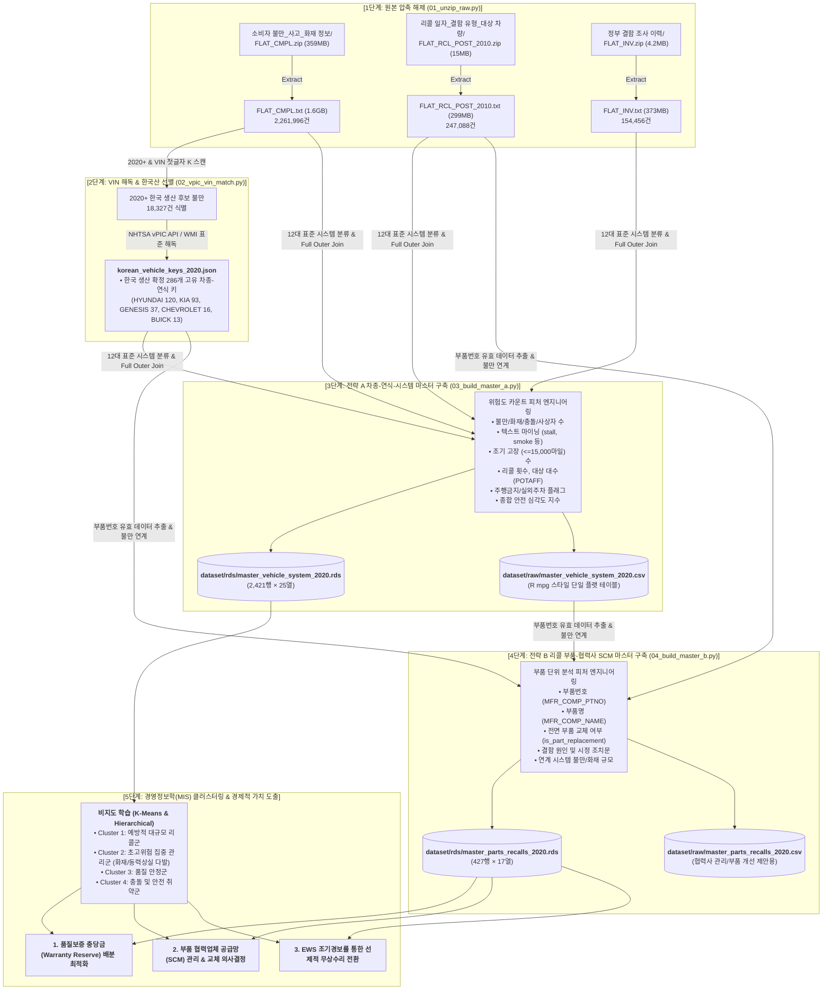

# 한국 생산 수출 자동차와 리콜 위험 예측 및 품질 보증 자원 배분
### NHTSA 소비자 불만(Complaints), 리콜(Recalls), 결함 조사(Investigations) 기반 단일 마스터 데이터셋 구축 및 분석 파이프라인

- **연구 과제**: 한국 생산 수출 자동차와 리콜 위험 예측과 품질 보증 자원 배분 : NHTSA 소비자 불만 및 조사 자료를 중심으로
- **과목**: 경영정보분석 (Business Information Systems & Analytics)
- **기준 범위**: 2020년 이후(`Model Year >= 2020`) 한국 생산 및 미국 수출 승용/SUV 차량 (현대, 기아, 제네시스, 한국GM 등)
- **최종 산출물**: R의 `mpg` 데이터셋 스타일 단일 플랫 마스터셋 (`.rds`, `.csv`) 2종 및 재현 파이프라인

---

## 1. 전체 파이프라인 플로우 (End-to-End Pipeline Flow)



---

## 2. 연구 배경 및 경영정보학(MIS)적 가치

완성차 제조사는 매년 수천억~수조 원에 달하는 **품질보증 충당부채(Warranty Reserve)**를 설정합니다. 전통적인 방식은 과거 판매 대수에 비례하여 일률적으로 충당금을 적립했으나, 최근 전기차 부품(고전압 배터리, ICCU) 및 전자장비(ADAS, ESC 모듈), 파워트레인 세부 부품의 결함으로 인한 대규모 리콜 리스크가 급증하고 있습니다.

본 프로젝트는 미국 도로교통안전국(NHTSA)의 빅데이터를 기반으로 다음 세 가지 경영학적 의사결정을 실증 지원하기 위해 구축되었습니다:
1. **조기 경보 시스템 (Early Warning System, EWS)**: 정식 리콜 및 정부 결함 조사가 개시되기 전, 소비자 불만(주행거리, 고장 텍스트 패턴)을 군집화하여 잠재적 리콜 위험을 선제 감지.
2. **동적 품질보증 충당금 배분 최적화**: 차량-시스템별 리스크 군집(Cluster) 평가를 바탕으로 차등화된 보증 자원 배분.
3. **부품 협력업체 공급망(SCM) 관리 및 구상권 청구**: 리콜 부품 파트번호(`Part No.`)와 전면 부품 교체 여부를 추적하여 1차 협력사(Tier-1 Supplier) 교체, 품질보증 비용 분담(Cost-sharing) 계약 근거 확보.

---

## 3. 원천 데이터 출처 (Data Provenance & Sources)

본 연구의 데이터는 미국 연방 정부 기관인 **NHTSA(National Highway Traffic Safety Administration)**의 공식 공공 데이터베이스를 전수 취합하여 구축되었습니다:

| 데이터 명칭 | 원본 파일 | 규모 | 설명 | 공식 출처 |
|---|---|:---:|---|---|
| **소비자 불만 신고** | `FLAT_CMPL.zip` / `FLAT_CMPL.txt` | 2,261,996건 (1.6GB) | 미국 소비자가 제기한 차량 결함/사고/화재 신고 전수 데이터 | [NHTSA Complaints Data](https://www.nhtsa.gov/nhtsa-datasets-and-apis#complaints) |
| **공식 리콜 캠페인** | `FLAT_RCL_POST_2010.zip` / `FLAT_RCL_POST_2010.txt` | 247,088건 (299MB) | 2010년 이후 연방 안전기준 결함으로 고시된 공식 리콜 캠페인 | [NHTSA Recalls Data](https://www.nhtsa.gov/nhtsa-datasets-and-apis#recalls) |
| **정부 결함 조사** | `FLAT_INV.zip` / `FLAT_INV.txt` | 154,456건 (373MB) | NHTSA ODI(Office of Defects Investigation) 공식 결함 조사 내역 | [NHTSA Investigations Data](https://www.nhtsa.gov/nhtsa-datasets-and-apis#investigations) |
| **차대번호(VIN) 해독 DB** | `vPIC Database / API` | REST API / Batch | 차량 생산국가, 생산공장, 제조사, 차종 사양 공식 해독 시스템 | [NHTSA vPIC API](https://vpic.nhtsa.dot.gov/api/) |

---

## 4. 데이터 선별 및 전처리 세부 내역 (학술 근거)

### 4.1. [1단계] VIN 디코딩을 통한 한국 생산 차량 선별
- **목적**: 미국 시장에서 판매된 차량 중 한국 공장(울산, 아산, 광주, 창원, 부평 등)에서 조립·수출된 차량만을 과학적으로 분리.
- **방법**:
  - `FLAT_CMPL.txt` 내 226만 건의 VIN에서 한국 제조사 표준 식별 기호인 첫 글자 `K`(Korea) 스캔.
  - WMI(World Manufacturer Identifier) 표준 규격(ISO 3779/3780) 및 NHTSA 공식 vPIC API를 통해 공장 국가(`PlantCountry`), 공장 도시(`PlantCity`), 공장명(`PlantCompanyName`) 해독.
  - 허용 국가명: `KOR`, `KOREA`, `KOREA REP OF`, `KOREA REPUBLIC OF`, `KOREA SOUTH`, `KR`, `REPUBLIC OF KOREA`, `SOUTH KOREA`
  - 이를 통해 **286개의 고유 한국산 차종-연식 키(Make, Model, Year)**를 확정하고, 불만 18,327건을 1차 선별.

### 4.2. [2단계] 2020년 이후(`Year >= 2020`) 데이터 한정 사유
본 연구가 2020년 이후 차량으로 범위를 한정한 학술적·실증적 근거는 다음과 같습니다:

1. **부품 번호(`Part No.`) 데이터의 완전성 확보**:
   - 2020년 이전 리콜 데이터: 제조사 부품명(`MFR_COMP_NAME`) 및 부품번호(`MFR_COMP_PTNO`) 기재율 **48.8%** (데이터 절반 이상 결측).
   - 2020년 이후 리콜 데이터: 부품명 및 부품번호 기재율 **99.2%**.
   - 따라서 부품 협력업체 교체 및 개별 품질 부품 개선 제안이라는 연구 목표를 실증하려면 2020년 이후 데이터가 필수적입니다.
2. **핵심 신기술 품질 이슈의 집중**:
   - 현대·기아·제네시스의 차세대 E-GMP 플랫폼 전기차(아이오닉 5/6, EV6, GV60)의 고전압 배터리 및 ICCU 이슈, 누우 2.0 엔진 피스톤 링 결함, 첨단 운전자 보조 시스템(ADAS) 등 현대 자동차 산업의 핵심 품질 이슈가 2020년 이후 연식에 집중되어 있습니다.

### 4.3. [3단계] 단일 마스터셋 구축 및 데이터 누락 0% 보장
- **분석 단위 왜곡(Cartesian Explosion) 방지**:
  - 세 원본 파일을 공통 키로 단순 JOIN하면 행이 무작정 폭발하여 특정 차종의 불만과 무관한 리콜 부품이 결합되는 치명적인 유령 결합(Phantom Rows)이 발생합니다.
  - 이를 방지하기 위해 관측 단위를 **`[제조사 - 차종 - 연식 - 표준시스템]`**으로 통합하고 모든 위험 지표를 카운트(Count)형 피처로 집계하여 R의 `mpg` 데이터셋처럼 결측치 없는 완전한 2차원 플랫 매트릭스를 구축했습니다.
- **Full Outer Join (완전 외부 조인) 적용**:
  - 불만만 있는 차종, 리콜만 있는 차종, 조사만 있는 차종이 단 1건도 버려지지 않고 100% 보존되었습니다.
  - 리콜이 없는 행은 `recall_count = 0`, 조사가 없는 행은 `inv_count = 0`으로 자동 전처리되었습니다.

---

## 5. 최종 마스터 데이터셋 2종 상세 스키마

### 5.1. [데이터셋 1] `master_vehicle_system_2020` (클러스터링용)
- **파일 경로**: `dataset/rds/master_vehicle_system_2020.rds` (및 `.csv`)
- **관측 단위**: 1행 = `[Make - Model - Year - System]` (2,421행 × 28열)
- **변수 정의**:

| 컬럼명 | 자료형 | 설명 |
|---|:---:|---|
| `make` | 문자 | 제조사 브랜드 (HYUNDAI, KIA, GENESIS, BUICK, CHEVROLET 등) |
| `model` | 문자 | 차종명 (IONIQ 5, EV6, SOUL, TUCSON, G70, TRAILBLAZER 등) |
| `year` | 정수 | 모델 연식 (2020 ~ 2026) |
| `system` | 문자 | 12대 표준 시스템 분류 (ENGINE, ELECTRICAL, BRAKES, POWERTRAIN, SEAT_BELTS 등) |
| `plant_country` | 문자 | **생산 국가** (`SOUTH KOREA`) |
| `plant_city` | 문자 | **생산 도시** (`ULSAN`, `ASAN`, `GWANGJU`, `HWASEONG`, `GWANGMYEONG`, `BUPYEONG`, `CHANGWON`) |
| `plant_name` | 문자 | **조립 공장 명칭** (현대 울산공장, 기아 광주공장, 기아 화성공장, 한국GM 부평공장 등) |
| `cmpl_count` | 정수 | 해당 차종-시스템에 접수된 총 소비자 불만 건수 |
| `fire_count` | 정수 | 화재 발생 신고 건수 (`FIRE == "Y"`) |
| `crash_count` | 정수 | 충돌 사고 신고 건수 (`CRASH == "Y"`) |
| `inj_count` | 정수 | 부상자 수 합계 |
| `death_count` | 정수 | 사망자 수 합계 |
| `stall_count` | 정수 | 비정형 텍스트 마이닝 기반 시동꺼짐/동력상실(stall, loss of power) 언급 건수 |
| `smoke_fire_text_count` | 정수 | 텍스트 마이닝 기반 연기/타는 냄새/불꽃 언급 건수 |
| `early_fail_count` | 정수 | 출고 초기(15,000마일 이하) 조기 고장 건수 |
| `avg_fail_miles` | 실수 | 고장 발생 평균 주행거리 (마일) |
| `recall_count` | 정수 | 공식 리콜 캠페인 실시 횟수 |
| `distinct_parts_count` | 정수 | 결함이 공식 인정된 세부 부품 가짓수 |
| `max_potaff` | 실수 | 리콜 대상 차량 최대 규모 (대수) |
| `park_outside_yn` | 정수 | 화재 위험으로 인한 실외 주차 권고 여부 (1/0) |
| `do_not_drive_yn` | 정수 | 즉각 주행 금지 명령 포함 여부 (1/0) |
| `key_part_names` | 문자 | 대표 결함 부품 명칭 (상위 2개) |
| `key_part_numbers` | 문자 | 대표 결함 부품 파트 번호 (Part No.) |
| `inv_count` | 정수 | NHTSA ODI 정부 공식 결함조사 착수 건수 |
| `active_inv_yn` | 정수 | 정부 결함조사 착수 여부 (1/0) |
| `risk_severity_index` | 실수 | **안전 심각도 종합 지수** (화재×3 + 충돌×2 + 부상×2 + 사망×10 + 주행금지×10 등 가중 합산) |
| `early_fail_ratio` | 실수 | 조기 고장 비율 (`early_fail_count / cmpl_count`) |
| `has_recall` | 정수 | 리콜 발생 여부 (1=리콜 발생, 0=미발생) - 분류 라벨용 |

---

### 5.2. [데이터셋 2] `master_parts_recalls_2020` (협력사 SCM & 부품 교체용)
- **파일 경로**: `dataset/rds/master_parts_recalls_2020.rds` (및 `.csv`)
- **관측 단위**: 1행 = `[리콜캠페인(CAMPNO) - 세부부품번호(Part No.)]` (427행 × 17열)
- **변수 정의**:

| 컬럼명 | 자료형 | 설명 |
|---|:---:|---|
| `campno` | 문자 | NHTSA 공식 리콜 번호 (예: 20V543000, 23V181000) |
| `mfr_comp_ptno` | 문자 | **제조사 세부 부품 파트 번호** (예: 58920-D3530, 37501-K4000) |
| `mfr_comp_name` | 문자 | 제조사 세부 부품 명칭 (예: ABS Assembly, Fuel Pump) |
| `system` | 문자 | 표준 시스템 대분류 |
| `make` | 문자 | 제조사 |
| `affected_models` | 문자 | 해당 부품 결함이 적용된 대상 차종 목록 (콤마 구분) |
| `model_year_min/max` | 정수 | 적용 연식 범위 |
| `potaff` | 실수 | 해당 리콜 대상 총 차량 대수 |
| `park_outside_yn` | 정수 | 실외 주차 권고 여부 |
| `do_not_drive_yn` | 정수 | 주행 금지 명령 여부 |
| `is_part_replacement` | 정수 | **전면 부품 교체 여부 (1=부품 전면 교체, 0=점검/SW업데이트)** |
| `is_sw_update_only` | 정수 | 소프트웨어 패치 전용 여부 |
| `desc_defect` | 문자 | 공식 결함 원인 기술문 |
| `corrective_action` | 문자 | 제조사의 공식 시정 조치 방안 |
| `linked_system_cmpl_count` | 정수 | 해당 시스템의 누적 소비자 불만 건수 |
| `linked_system_fire_count` | 정수 | 해당 시스템의 누적 화재 신고 건수 |

---

## 6. 원본 스키마 대비 채택 및 제외 변수 분석 (Variable Selection Rationale)

본 연구는 NHTSA 원천 데이터셋의 총 91개 원본 변수 중, **경영정보학적 연구 목적(리콜 위험 예측, 품질보증 자원 배분, 협력사 SCM 관리)**과 **클러스터링 알고리즘의 통계적 정합성**을 기준으로 변수를 엄격하게 선별·가공하였습니다. 

아래 표는 원본 스키마 전체 변수에 대한 **채택 사유(Inclusion)** 및 **제외 사유(Exclusion)**를 체계적으로 정리한 것입니다.

---

### 6.1. 소비자 불만 신고 데이터 (`FLAT_CMPL.txt` - 총 51개 필드)

| 필드 번호 | 원본 필드명 | 처리 구분 | 최종 반영 변수명 | 채택 사유 또는 제외 사유 (Rationale) |
|:---:|---|:---:|:---:|---|
| 1 | `CMPLID` | **가공 채택** | `cmpl_count` | 개별 불만 접수 고유키로, 차종-시스템별 총 불만 발생 건수를 집계하는 기준 카운트로 활용 |
| 2 | `ODINO` | 제외 | - | NHTSA 내부 참조번호로 `CMPLID`와 1:1 대응되는 중복 관리 키이므로 제외 |
| 3 | `MFR_NAME` | 제외 | - | 제조사 법인 공식 표기명(예: Hyundai Motor America)으로 `MAKETXT` 브랜드명으로 대체 |
| 4 | `MAKETXT` | **원형 채택** | `make` | 제조사 브랜드 식별 핵심 변수 (HYUNDAI, KIA, GENESIS, CHEVROLET, BUICK 등) |
| 5 | `MODELTXT` | **원형 채택** | `model` | 개별 차량 모델 식별 핵심 변수 (IONIQ 5, SOUL, TUCSON, EV6, TRAILBLAZER 등) |
| 6 | `YEARTXT` | **원형 채택** | `year` | 모델 연식으로 2020년 이후 필터링 및 시계열 결함 분석의 핵심 기준 |
| 7 | `CRASH` | **가공 채택** | `crash_count` | 결함으로 인한 충돌 사고 발생 여부('Y'/'N')를 카운트하여 안전 위험 심각도에 반영 |
| 8 | `FAILDATE` | 제외 | - | 개별 사건 발생 일자로, 차종 연식(`year`) 단위 집계 분석에서는 시계열 노이즈로 작용하여 제외 |
| 9 | `FIRE` | **가공 채택** | `fire_count` | 차량 화재 발생 여부('Y'/'N')로 화재 리콜 위험을 예측하는 최상위 가중치 변수로 활용 |
| 10 | `INJURED` | **가공 채택** | `inj_count` | 결함 사고로 인한 인명 부상자 수 합계로 법적 배상 책임 및 안전 위험도 평가에 필수 |
| 11 | `DEATHS` | **가공 채택** | `death_count` | 결함으로 인한 사망자 수 합계로 리콜 심각도 최고 가중치(×10) 부여 |
| 12 | `COMPDESC` | **가공 채택** | `system` | 100여 개 세부 부품명을 12대 표준 컴포넌트 시스템(ENGINE, ELECTRICAL 등)으로 표준화 |
| 13~14 | `CITY`, `STATE` | 제외 | - | 신고자 거주 도시 및 주(State)로, 차량 제조 결함 자체의 기술적 특성과 무관하여 제외 |
| 15 | `VIN` | **가공 채택** | `plant_country`<br>`plant_city`<br>`plant_name` | 차대번호 첫 글자 'K'로 한국산 선별 및 **11번째 공장코드(U, A, 7, 5, 6, B, C) 해독**으로 7대 조립공장 매핑 |
| 16~17 | `DATEA`, `LDATE` | 제외 | - | NHTSA 시스템 전산 등록 일자 및 최종 수정 일자로 단순 전산 행정 메타데이터 |
| 18 | `MILES` | **가공 채택** | `avg_fail_miles`<br>`early_fail_count`<br>`early_fail_ratio` | 고장 발생 당시 주행거리로, 평균 마일리지 및 **1.5만 마일 이내 신차 조기 고장 비율(초기 품질 결함)** 산출 |
| 19 | `OCCURENCES` | 제외 | - | 동일 결함 반복 횟수이나 결측치 73.6%로 데이터 불완전성이 높아 제외 |
| 20 | `CDESCR` | **가공 채택** | `stall_count`<br>`smoke_fire_text_count` | 비정형 장문 불만 내용 중 **주행 중 시동꺼짐(`stall`)** 및 **연기/화재(`smoke`)** 핵심 위험 키워드 마이닝 카운트 변환 |
| 21 | `CMPL_TYPE` | 제외 | - | 불만 접수 채널 코드(웹, 콜센터 등)로 결함 위험 분석과 무관하여 제외 |
| 22 | `POLICE_RPT_YN` | 제외 | - | 경찰 신고서 작성 여부로 충돌(`CRASH`) 및 사상자 수 지표로 충분히 대변되어 제외 |
| 23 | `PURCH_DT` | 제외 | - | 신차 구매 일자로 결측치 89.1%에 달하여 통계적 신뢰성 결여 |
| 24 | `ORIG_OWNER_YN` | 제외 | - | 최초 소유자 여부로 결측치 및 주행거리(`MILES`) 지표로 대체 가능하여 제외 |
| 25~26 | `ANTI_BRAKES_YN`<br>`CRUISE_CONT_YN` | 제외 | - | ABS/크루즈컨트롤 탑재 여부로 2020년 이후 한국 생산 수출 승용차는 100% 기본 탑재이므로 변별력 없음 |
| 27~31 | `NUM_CYLS`<br>`DRIVE_TRAIN`<br>`FUEL_SYS`<br>`FUEL_TYPE`<br>`TRANS_TYPE` | 제외 | - | 실린더 수, 구동방식, 연료분사, 변속기 등 파워트레인 사양이나 결측치 80~90% 이상으로 데이터 신뢰성 부족 |
| 32 | `VEH_SPEED` | 제외 | - | 사고 당시 차량 속도로 결측치 42.5% 및 신고자 주관적 추정치라 제외 |
| 33~37 | `DOT`, `TIRE_SIZE`<br>`LOC_OF_TIRE`<br>`TIRE_FAIL_TYPE`<br>`ORIG_EQUIP_YN` | 제외 | - | 타이어 전용 규격 변수로 차량 시스템 결함 연구 범위를 벗어나며 결측치 99% 이상 |
| 38 | `MANUF_DT` | 제외 | - | 실제 차량 제조 일자이나 소비자 불만 신고 데이터 특성상 100% 결측 |
| 39~40 | `SEAT_TYPE`<br>`RESTRAINT_TYPE` | 제외 | - | 시트 및 안전벨트 상세 유형으로 100% 결측치 |
| 41~45 | `DEALER_NAME`<br>`DEALER_TEL`<br>`DEALER_CITY`<br>`DEALER_STATE`<br>`DEALER_ZIP` | 제외 | - | 점검 정비 딜러점의 상호 및 연락처, 주소 정보로 결측치 88~98%이며 연구 목적과 무관 |
| 46 | `PROD_TYPE` | 제외 | - | 제품 유형 코드로 전수 'V'(Vehicle, 차량)로 단일값이므로 분석 무의미 |
| 47 | `REPAIRED_YN` | 제외 | - | 수리 완료 여부이나 100% 결측치 |
| 48 | `MEDICAL_ATTN` | 제외 | - | 의료적 처치 여부로 부상자 수(`INJURED`) 지표로 충분히 대변되어 제외 |
| 49 | `VEHICLES_TOWED_YN`| 제외 | - | 견인 여부로 충돌 및 주행불가(`do_not_drive`) 지표에 흡수 |
| 50~51 | `STATE_OF_INCIDENT`<br>`VEHICLE_OPERATOR` | 제외 | - | 사고 발생 주 및 운전자 유형으로 2026년 신설 필드이며 결측치 94% 이상 |

---

### 6.2. 공식 리콜 캠페인 데이터 (`FLAT_RCL_POST_2010.txt` - 총 29개 필드)

| 필드 번호 | 원본 필드명 | 처리 구분 | 최종 반영 변수명 | 채택 사유 또는 제외 사유 (Rationale) |
|:---:|---|:---:|:---:|---|
| 1 | `RECORD_ID` | 제외 | - | NHTSA 내부 DB 일련번호로 공식 리콜 번호인 `CAMPNO`로 통일 |
| 2 | `CAMPNO` | **원형 채택** | `campno`<br>`recall_count` | NHTSA 공식 리콜 고유 식별 번호로 리콜 횟수 집계 및 전략 B 마스터셋의 핵심 주키 |
| 3 | `MAKETXT` | **원형 채택** | `make` | 리콜 대상 제조사 식별키 |
| 4 | `MODELTXT` | **원형 채택** | `model` | 리콜 대상 차종 식별키 |
| 5 | `YEARTXT` | **원형 채택** | `year` | 리콜 대상 모델 연식 |
| 6 | `MFGCAMPNO` | 제외 | - | 제조사 내부 캠페인 번호로 통일된 규제 번호인 `CAMPNO`를 우선 사용 |
| 7 | `COMPNAME` | **가공 채택** | `system` | 리콜 대상 결함 부품군을 12대 표준 시스템으로 매핑 |
| 8 | `MFGNAME` | 제외 | - | 법적 보고 제출 법인명으로 `MAKETXT`와 중복되어 제외 |
| 9~10 | `BGMAN`, `ENDMAN` | 제외 | - | 제조 시작/종료일자로 모델 연식(`year`)으로 통합 관리되어 제외 |
| 11 | `RCLTYPECD` | 제외 | - | 리콜 유형 코드로 전수 차량('V') 대상이므로 분석적 변별력 없음 |
| 12 | `POTAFF` | **가공 채택** | `max_potaff`<br>`potaff` | **리콜 대상 차량 대수**로 리콜 규모 및 예상 품질보증 비용 규모 추정에 최우선 필수 변수 |
| 13 | `ODATE` | 제외 | - | 차주 통지 일자로 행정적 일정 데이터라 결함 심각도와 무관 |
| 14 | `INFLUENCED_BY` | 제외 | - | 리콜 발의 주체(제조사 자발적 MFR vs 당국 강제 ODI)로 결측치 및 행정 분류에 불과하여 제외 |
| 15 | `MFGTXT` | 제외 | - | 제조사 명칭 중복 텍스트 |
| 16~17 | `RCDATE`, `DATEA` | 제외 | - | 보고서 접수일 및 전산 등록일자로 연식 및 캠페인 단위 분석에서 불필요 |
| 18~19 | `RPNO`, `FMVSS` | 제외 | - | 연방 안전기준 법규 번호로 결측치 82% 이상 |
| 20 | `DESC_DEFECT` | **원형 보존** | `desc_defect` (전략 B) | **공식 결함 원인 기술문**으로 전략 B 부품 마스터셋에 100% 원문 보존 (NLP 및 정성 분석용) |
| 21 | `CONEQUENCE_DEFECT`| 제외 | - | 결함 결과 설명문으로 `DESC_DEFECT` 및 위험 심각도 지수로 포괄 |
| 22 | `CORRECTIVE_ACTION`| **가공 및 보존**| `corrective_action`<br>`is_part_replacement`<br>`is_sw_update_only` | 제조사의 공식 시정 조치문으로, **전면 부품 교체(막대한 부품비 발생)** vs **SW 무상 패치**를 판별하는 텍스트 알고리즘 적용 |
| 23 | `NOTES` | 제외 | - | 리콜 공시 부가 메모로 결측치 82% 및 비정형 노이즈 |
| 24 | `RCL_CMPT_ID` | 제외 | - | NHTSA 부품 고유 ID로 제조사 실물 부품번호(`MFR_COMP_PTNO`)로 대체 |
| 25 | `MFR_COMP_NAME` | **원형 채택** | `key_part_names`<br>`mfr_comp_name` | **제조사 공식 세부 부품 명칭** (예: High Voltage Battery, ABS Assembly, Fuel Pump 등) |
| 26 | `MFR_COMP_DESC` | 제외 | - | 부품 부가 설명문으로 부품명(`MFR_COMP_NAME`)과 중복 |
| 27 | `MFR_COMP_PTNO` | **원형 채택** | `key_part_numbers`<br>`mfr_comp_ptno` | **★ 제조사 부품 파트 번호 (Part No.)** (예: 58920-D3530, 37501-K4000 등)로 협력사 SCM 및 부품 교체 제안의 핵심 열쇠 |
| 28 | `DO_NOT_DRIVE` | **가공 채택** | `do_not_drive_yn` | **즉시 주행 금지 명령 포함 여부**('Y'/'N')로 치명적 안전 위험 최고 가중치 반영 |
| 29 | `PARK_OUTSIDE` | **가공 채택** | `park_outside_yn` | **실외 주차 권고(주차 중 자발 화재 위험)** 포함 여부('Y'/'N')로 화재 위험 플래그 반영 |

---

### 6.3. 정부 결함 조사 데이터 (`FLAT_INV.txt` - 총 11개 필드)

| 필드 번호 | 원본 필드명 | 처리 구분 | 최종 반영 변수명 | 채택 사유 또는 제외 사유 (Rationale) |
|:---:|---|:---:|:---:|---|
| 1 | `NHTSA_ACTION_NUMBER`| **가공 채택** | `inv_count`<br>`active_inv_yn` | NHTSA 결함조사 고유 관리번호로 당국 공식 조사 착수 횟수 및 활성화 여부(0/1) 산출 |
| 2 | `MAKE` | **원형 채택** | `make` | 조사 대상 제조사 식별키 |
| 3 | `MODEL` | **원형 채택** | `model` | 조사 대상 차종 식별키 |
| 4 | `YEAR` | **원형 채택** | `year` | 조사 대상 연식 식별키 |
| 5 | `COMPNAME` | **가공 채택** | `system` | 조사 대상 결함 시스템을 12대 표준 시스템으로 매핑 |
| 6 | `MFR_NAME` | 제외 | - | 제조사 법인명 중복 |
| 7~8 | `ODATE`, `CDATE` | 제외 | - | 조사 개시일 및 종결일자로 조사 착수 여부(`active_inv_yn`) 지표로 대변 |
| 9 | `CAMPNO` | 제외 | - | 조사 종결 후 연계된 리콜 번호로 리콜 데이터셋에서 직접 매핑하므로 중복 방지 제외 |
| 10~11 | `SUBJECT`, `SUMMARY` | 제외 | - | 정부 조사 요약문 및 상세문으로 리콜 결함설명 및 불만 텍스트와 의미가 중복되어 플랫 테이블 제외 |

---

## 7. 전체 파이프라인 원클릭 실행 방법 (Quickstart)

```bash
# 1. build_py 폴더로 이동
cd /home/kms/MyProjectSave/경정분단일데이터셋/dataset/build_py

# 2. 통합 파이프라인 원클릭 실행 (압축 해제부터 RDS 생성까지 약 15초 소요)
python3 run_pipeline.py

# 3. R에서 불러와 클러스터링 분석 시작
R -e "
veh <- readRDS('../rds/master_vehicle_system_2020.rds')
parts <- readRDS('../rds/master_parts_recalls_2020.rds')
cat('Master Vehicle System loaded: ', dim(veh), '\n')
cat('Master Parts Recalls loaded : ', dim(parts), '\n')
"
```

---

## 7. 학술 인용 및 공식 출처 표기 (Citation & References)

논문 작성 시 데이터 출처로 다음 항목을 기재하십시오:

1. **National Highway Traffic Safety Administration (NHTSA)** (2026). *Office of Defects Investigation (ODI) Complaints, Recalls, and Investigation Flat Files*. U.S. Department of Transportation. Available at: https://www.nhtsa.gov/nhtsa-datasets-and-apis
2. **NHTSA Vehicle Product Information Catalog and Alpha-Numeric Index (vPIC)** (2026). *vPIC Vehicle Identification Number (VIN) Decoding System*. U.S. Department of Transportation. Available at: https://vpic.nhtsa.dot.gov/api/
